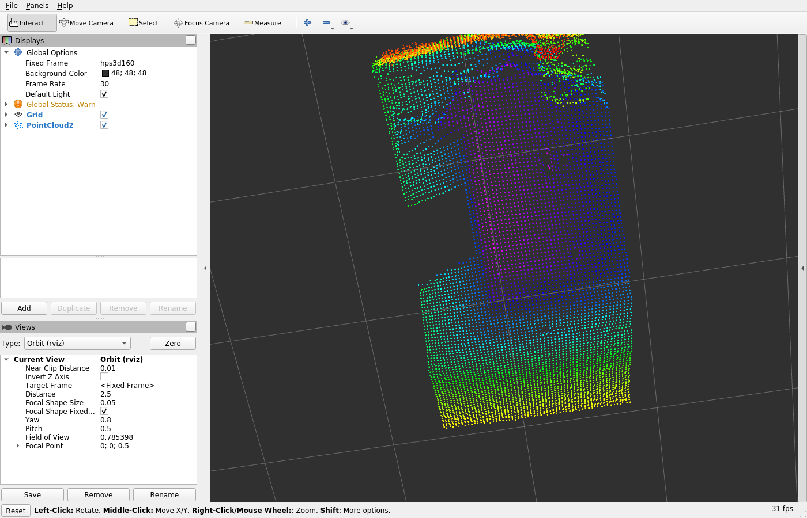

# hps3d160_max — Max-utilization system for HPS-3D160-U (USB + IO)

A ROS-friendly C++ system that exercises the full feature set of the Hypersen HPS-3D160-U
depth camera: continuous and single capture, ROI groups, distance/smooth/edge filters,
optical-path compensation, point-cloud publishing and recording, multi-camera coordination,
reconnect and health monitoring.

## Build (standalone, no ROS)

```bash
mkdir -p build && cd build
cmake .. -DHPS3D160_MAX_WITH_ROS=OFF
make -j$(nproc)
./hps3d160_max_node --mode usb --port /dev/ttyACM0 --record-dir ./out
```

## Build (ROS/catkin)

```bash
# inside your catkin workspace src/
ln -s /path/to/hps3d160_max .
cd .. && catkin_make
source devel/setup.bash
roslaunch hps3d160_max hps3d160.launch
```

### ROS on WSL (Docker)

Ubuntu 24.04 has no ROS 1 Noetic binaries, so a container is used:

```bash
./scripts/ros_docker.sh build   # image + catkin build
./scripts/ros_docker.sh node    # roscore + camera node
./scripts/ros_docker.sh rviz    # RViz with the prepared config
./scripts/ros_docker.sh stop
```

Details and validation results: `docs/ros_docker.md`.

## Features mapped to SDK

| Feature | SDK API |
|---|---|
| USB/Ethernet connect | HPS3D_USBConnectDevice / HPS3D_EthernetConnectDevice |
| Reconnect | HPS3D_EthternetReconnection |
| Continuous/single capture | HPS3D_StartCapture / HPS3D_SingleCapture |
| ROI group | HPS3D_SetROIGroupID |
| Distance filter | HPS3D_SetDistanceFilterConf |
| Smooth filter | HPS3D_SetSmoothFilterConf |
| Distance offset | HPS3D_SetDistanceOffset |
| Optical path calibration | HPS3D_SetOpticalPathCalibration |
| Edge filter | HPS3D_SetEdgeFilterEnable |
| Multi-camera code | HPS3D_SetMultiCameraCode |
| Point cloud | HPS3D_DepthData_t.point_cloud_data |
| Export/save settings | HPS3D_ExportSettings / HPS3D_SaveSettings |

## Using with WSL (usbipd)

When the device is connected to Windows as `COM3`, expose it to WSL 2:

```powershell
# PowerShell (Administrator)
usbipd list
usbipd bind --busid 2-2
usbipd attach --wsl --busid 2-2
```

Then in WSL:

```bash
ls /dev/ttyACM0
sudo chmod 777 /dev/ttyACM0
./build/hps3d160_max_node --port /dev/ttyACM0 --single --max-frames 5 --record-dir ./out
```

Detach when done:

```powershell
usbipd detach --busid 2-2
```

## Build on Windows (native)

1. Open a Visual Studio 2017/2019/2022 Developer Command Prompt.
2. Ensure `HPS3D160_SDK_X64.dll` and `.lib` are in the link path (`third_party/hps_sdk/lib` or system PATH).
3. Configure with CMake (MSVC generator) and build:

```bat
mkdir build && cd build
cmake .. -G "Visual Studio 16 2019" -A x64 -DHPS3D160_MAX_WITH_ROS=OFF
cmake --build . --config Release
```

4. Run with the device on `COM3`:

```bat
Release\hps3d160_max_node.exe --port COM3 --single --max-frames 5 --record-dir .\out
```

Note: the Linux `.so`/`.a` in `third_party/hps_sdk/lib` are not used on Windows; use the `.dll`/`.lib` from the SDK instead.

## Hardware capability report

The SDK library exports a much richer API than the public wrapper. This project
maps the public handle onto the internal one (`src/sdk_bridge.cpp`) and can dump
**every** configuration the sensor exposes:

```bash
./build/hps3d160_max_node --port /dev/ttyACM0 --probe --probe-out report.json
```

The report contains identity, link parameters, HDR/integration, filters, ROI
geometry and thresholds, GPIO configuration, interference detection, point cloud
options, obstacle settings and the sensor temperature.
A real capture from an HPS-3D160-U is kept in `docs/hardware_report.json`.

See `docs/CAPABILITIES.md` for the full hardware capability map.

## Frame rate

```bash
./build/hps3d160_max_node --port /dev/ttyACM0 --bench 10 --bench-out throughput.json
```

Measured on an HPS-3D160-U: **~42.5 fps** in `auto_hdr` (23.6 ms/frame),
33 fps in `disable`, 19.5 fps in `simple_hdr` and 16.8 fps in `super_hdr`
(4 synthesised frames). End-to-end in ROS the same 42.5 Hz is sustained, so the
sensor — not the pipeline — is the limit. Full table in `docs/throughput.md`.

## HDR comparison (SNR)

```bash
./build/hps3d160_max_node --port /dev/ttyACM0 --hdr-compare 30 --hdr-out hdr.json
```

Switches the sensor between `disable` / `auto_hdr` / `super_hdr` / `simple_hdr`
and reports coverage, weak-signal and saturation ratios, spatial noise
(std-dev over 8x8 patches), temporal jitter and an SNR proxy per mode.
A real measurement is stored in `docs/hdr_comparison.json`, and the analysis
with the per-direction recommendation in `docs/hdr_guide.md`.


## ROS publisher

The node publishes `sensor_msgs/PointCloud2` on `/hps3d160/point_cloud`:

- **organized cloud** (160 × 60) by default, so it can be aligned with a depth
  image and with the sensor ROI coordinates; invalid pixels are `NaN`
- extra `distance` field (float, metres) alongside `x/y/z` (metres)
- the cloud is **metric**: it is rebuilt from the distance matrix with the
  sensor optics, so `|(x,y,z)| == distance` exactly (radial error 0,000 mm).
  The point cloud shipped by the firmware is *not* metric (it uses a tangent
  approximation and the axial depth as `z`, up to 27 % error at the FoV border)
  — see `docs/scene_analysis.md`
- parameters: `point_cloud_topic`, `base_frame_id`, `organized_cloud`

The ROS code path is covered by a test that runs against a minimal ROS mock, so
it can be validated without a ROS installation:

```bash
./scripts/test_ros_publisher.sh
```

## Validation



Real capture rendered by RViz from the organised point cloud.

## Notes

- The SDK core is proprietary; only headers and x86_64 Linux libraries are bundled.
- For ARM targets, replace `third_party/hps_sdk/lib` with the matching `.so`/`.a`.
- Recording formats: CSV (always) + per-frame XYZ; PCD when built with PCL.
- The device appears as `COM3` on Windows and `/dev/ttyACM0` in WSL after `usbipd attach`.