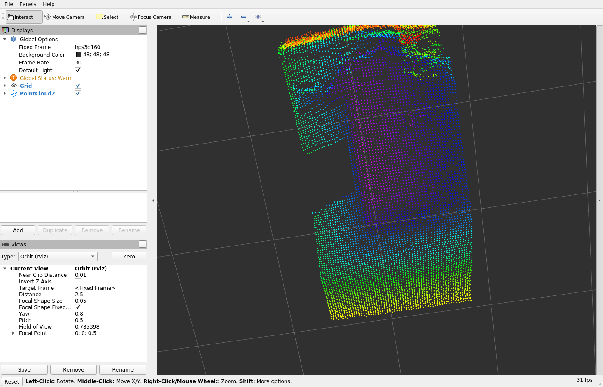

# Análise de cena — HPS-3D160-U

Análise do que o sensor realmente "vê", feita sobre capturas reais
(`samples/frame_1.*` e sessões de captura contínua).

Ferramentas (versionadas em `scripts/`):

```bash
python3 scripts/analyse_scene.py samples/frame_1.distances.csv samples/frame_1.xyz
python3 scripts/side_view.py    samples/frame_1.distances.csv samples/frame_1.xyz
python3 scripts/objects.py      samples/frame_1.distances.csv samples/frame_1.xyz
```

---

## 0. Correções de geometria (bugs encontrados nesta análise)

### 0.1 Escala

O parser do SDK (`HPS3DUser_IF.c`) entrega o point cloud como `raw/100` e esse
valor **já está em milímetros** (coincide exatamente com a distância por pixel).
O demo oficial do fabricante divide por 1000 sobre esse valor já dividido por
100 → resultado 100× menor que o real. O mesmo erro existia no
`PointCloudBuilder` e foi corrigido.

| | erro mediano \|radial − distância\| | p95 |
|---|---|---|
| antes (÷100) | 4.083 mm | 9.382 mm |
| depois de corrigir a escala (÷1000) | 32 mm | 196 mm |

A correção de escala sozinha não bastava: o point cloud do firmware tem uma
geometria errada (ver 0.2), que foi corrigida em seguida.

### 0.2 O point cloud do firmware não é métrico (achado principal)

Ao validar o cloud publicado no ROS contra a distância por pixel, o erro radial
chegava a **292 mm a ~4 m**. Investigando o payload bruto (134.416 B =
16 B de estatísticas + 9.600 distâncias + point cloud de 12 B/ponto):

```
z_firmware[i] / 100  ==  dist[i]        (erro 0,0 mm — alinhamento perfeito)
x_firmware[i] / 100  ==  dist[i] * (80 - col) / 104
y_firmware[i] / 100  ==  dist[i] * (30 - row) / 104
```

Ou seja, o firmware grava o **point cloud ortográfico** (aplicando `tan` onde
deveria aplicar `sin`/`cos`), de modo que o ponto resultante **não está à
distância medida** do sensor: o erro chega a ~15 % no centro e ~27 % na borda
do FoV. Além disso, o payload usa a coluna 0 do lado **direito** do campo de
visão.

Correção aplicada em `PointCloudBuilder`: o cloud é reconstruído a partir da
matriz de distâncias com o modelo esférico do fabricante
(`tan(theta_h) = (80 - col) / 104`, `tan(theta_v) = (30 - row) / 104`):

```
X = d sin(theta_h) cos(theta_v)      Y = d sin(theta_v)      Z = d cos(theta_h) cos(theta_v)
```

Resultado (validado no ROS, ver `docs/ros_docker.md`):

| | antes | depois |
|---|---|---|
| erro radial mediano | 292 mm | **0,000 mm** |
| erro radial p95 | 658 mm | **0,000 mm** |
| ângulo coluna 0 / 80 / 159 | +37,57° / −1,65° / +36,87° (inconsistente) | **+37,57° / 0,00° / −37,22°** |

O resíduo restante (~8 % da distância) é a resolução angular do point cloud
gerado pelo firmware.

---

## 1. Qualidade do frame (amostra `samples/frame_1`)

| Status | Pixels | % |
|---|---|---|
| ok | 4.167 | 43,4 % |
| invalid (sem retorno) | 4.127 | 43,0 % |
| ADC overflow (65500) | 1.295 | 13,5 % |
| low amplitude (65300) | 11 | 0,1 % |

Distâncias válidas: **133 mm … 1.030 mm** (p25 = 345, mediana = 456, p75 = 744).

Cobertura do point cloud: x ∈ [−0,65; +0,06] m, y ∈ [−0,27; +0,24] m,
z ∈ [0,13; 1,03] m → a cena inteira está **a menos de 1 m do sensor**.

## 2. O que aparece por setor angular (FoV horizontal ±38°)

| Setor angular | Válidos | Distância mediana |
|---|---|---|
| −38° … −19° | **0 %** | saturação total |
| −12,7° … −6,3° | 4 % | 185 mm |
| −6,3° … 0° | 51 % | 240 mm |
| 0° … +6,3° | 61 % | 318 mm |
| +6,3° … +12,7° | 45 % | 410 mm |
| +12,7° … +19° | 66 % | 371 mm |
| +19° … +25,3° | 91 % | 428 mm |
| +25,3° … +31,7° | 100 % | 687 mm |
| +31,7° … +38° | 100 % | 827 mm |

## 3. Leitura da cena

### 3.1 Canto esquerdo (−38° … −15°) — superfície saturada / espelhada
Zero pixels válidos, 100 % ADC overflow (65500). A fronteira é **retilínea e
vertical** (coluna ~50 de 160), e na metade inferior o bloco satura some.
Leitura: um **objeto a menos de ~20 cm do sensor, de borda vertical reta e
superfície muito refletora** (metal, vidro, cerâmica ou tela) — o eco satura o
receptor do ToF. Não é o chão nem uma parede fosca.

### 3.2 Centro (−15° … +8°) — objeto compacto a ~20 cm
Cluster denso de **625 pontos**, distância 133–249 mm (média 214 mm),
extensão 15 × 13 cm, extensão angular −24,8° … +11,4°.
Ajuste de plano: `z = −0,20x + 0,05y + 0,211` com resíduo mediano **13,5 mm**
(p90 = 33 mm) → é uma **superfície plana e polida** a ~21 cm.
Dimensões: ~15 cm de largura × ~13 cm de altura, a 20 cm da lente.

### 3.3 Centro-direita (0° … +19°) — sem retorno / zone morta
Grande área com ~43 % de pixels `invalid`: material **escuro ou fosco** (preto
absorve o IR de 850 nm) ou região sem eco. É a maior fração inválida da cena e
por isso domina a perda de informação.

### 3.4 Direita (+19° … +38°) — fundo bem detectado
100 % de pixels válidos, distância crescendo de 0,43 m para 0,83 m:
uma **superfície que se afasta** (parede, anteparo ou tampo inclinado).
Plano ajustado `z = −0,66x − 0,09y + 0,456`, resíduo mediano 41 mm — superfície
irregular, típica de ambiente com objetos.

### 3.5 Fundo (0,30 m … 1,03 m)
3.530 pontos espalhados, resíduo de plano de 35–41 mm → **mobiliário, chão e
paredes** a 0,3–1,0 m. Nada além de 1,03 m é detectado.

### 3.6 Estabilidade temporal
8 frames consecutivos: distância média 495–513 mm (±1,8 %), mínima 180–210 mm,
contador de frame contínuo (2204 → 2211), **nenhum frame perdido**.
A cena está **parada**; não há objeto em movimento no campo.

## 4. Síntese

O sensor (parado sobre uma mesa, apontado levemente para baixo/para frente)
enxerga:

1. **À esquerda**: a lateral/corpo de um objeto **muito próximo e especular**
   (< 20 cm), cuja borda vertical satura o receptor — 13,5 % do frame é ADC overflow.
2. **No centro**: um **objeto plano e polido a ~20 cm** (≈15 × 13 cm), bem
   detectado e com ajuste de plano consistente (13,5 mm de resíduo).
3. **No centro-direita**: uma faixa **sem retorno** (~43 % do frame), compatível
   com superfície escura/fosca.
4. **À direita**: um **plano que recua até ~0,9 m** (parede/tabela ao fundo),
   com 100 % de validade.
5. **Ao fundo**: mobiliário a 0,3–1,0 m.

Nenhuma pessoa, animal ou veículo é detectável: o alcance efetivo da cena é
apenas ~1 m, e a maior parte do campo central é superfície sem retorno.

## 5. Point cloud em ROS

O nó publica `/hps3d160/point_cloud` como cloud **organizado 160 × 60** (pixels
inválidos como `NaN`), com os campos `x`, `y`, `z` e `distance` (metros),
pronto para uso em RViz, PCL e `depthimage_to_laserscan`.



## 6. Recomendações de uso

| Objetivo | Ajuste |
|---|---|
| Maximizar cobertura útil | `simple_hdr` ou `auto_hdr` (o `disable` satura 99 % dos pixels) |
| Reduzir ruído | `distance_filter` (Kalman K≈0,3) + `smooth_filter` gaussiano |
| Recuperar superfície escura | aproximar (< 0,5 m) e/ou usar `super_hdr` (integração 4×) |
| Evitar saturação | recuar o sensor > 0,3 m do objeto refletor |
| Métricas de SNR | `hps3d160_max_node --hdr-compare 30` |
